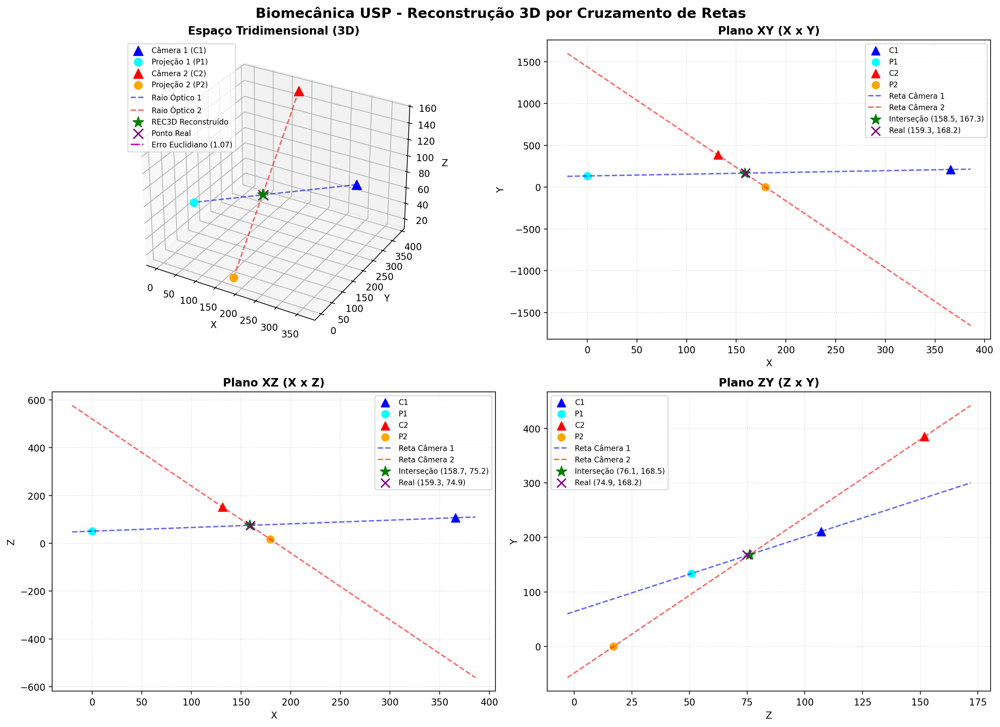

# Reconstrução 3D por Cruzamento de Retas (Biomecânica - USP)

[](https://www.python.org/)
[](https://opensource.org/licenses/MIT)
[](https://www5.usp.br/)

Projeto desenvolvido para a disciplina de **Biomecânica da Universidade de São Paulo (USP)** — **Tarefa 1**.

Este repositório substitui e aprimora a planilha original [`cruzreta.xlsx`](cruzreta.xlsx), fornecendo um script em Python modular, intuitivo, simplificado e com múltiplas interfaces (CLI interativo, relatórios formatados, geração de gráficos 2D/3D e dashboard Web interativo).

---

## 🎯 Objetivo

Estimar as **coordenadas tridimensionais (X, Y, Z)** de um ponto no espaço através do **Método de Cruzamento de Retas (Ray Crossing)** a partir das posições focais de duas câmeras e de suas respectivas projeções em planos ortogonais.

---

## 📐 Fundamentação Teórica e Fórmulas

Cada câmera $i \in \{1, 2\}$ possui uma posição focal $C_i = (X_{ci}, Y_{ci}, Z_{ci})$ e um ponto imagem de projeção $P_i = (X_{pi}, Y_{pi}, Z_{pi})$.

O método resolve o cruzamento projetando as retas nos **três planos ortogonais**:

### 1. Equação da Reta em cada Plano Bidimensional
Para um plano com eixo horizontal $H$ e vertical $V$:
- **Coeficiente Angular (Slope):**
  $$mr = \frac{V_p - V_c}{H_p - H_c}$$
- **Coeficiente Linear (Intercept):**
  $$br = -1 \cdot (mr \cdot H_c - V_c) = V_c - mr \cdot H_c$$

### 2. Cruzamento Analítico no Plano 2D
A interseção entre a reta da Câmera 1 ($V = mr_1 \cdot H + br_1$) e a da Câmera 2 ($V = mr_2 \cdot H + br_2$) é dada por:
$$H = \frac{-(mr_2 \cdot H_{c2}) + V_{c2} + (mr_1 \cdot H_{c1}) - V_{c1}}{mr_1 - mr_2}$$
$$V = mr_1 \cdot (H - H_{c1}) + V_{c1}$$

### 3. Reconstrução 3D Final (REC3D)
Cada coordenada 3D é estimada em dois planos independentes. O valor final é a **média aritmética**:
- $$X_{rec} = \frac{X_{xy} + X_{xz}}{2}$$
- $$Y_{rec} = \frac{Y_{xy} + Y_{zy}}{2}$$
- $$Z_{rec} = \frac{Z_{xz} + Z_{zy}}{2}$$

### 4. Análise de Erro (Comparação com Gabarito Real)
- **Erro com sinal:** $\text{Erro}_k = \text{Real}_k - \text{REC3D}_k$
- **Erro absoluto:** $|\text{Erro}_k| = |\text{Real}_k - \text{REC3D}_k|$
- **Erro Total Médio (da planilha):**
  $$\text{Erro Total} = \frac{|\text{Erro}_x| + |\text{Erro}_y| + |\text{Erro}_z|}{3}$$
- **Erro Euclidiano 3D:**
  $$\text{Distância 3D} = \sqrt{\text{Erro}_x^2 + \text{Erro}_y^2 + \text{Erro}_z^2}$$

---

## 📊 Comparativo: Planilha Excel vs. Script Python

| Parâmetro / Métrica | Planilha `cruzreta.xlsx` | Script `cruzreta.py` | Concordância |
| :--- | :---: | :---: | :---: |
| **X Reconstruído (REC3D)** | `158.6063` | `158.6063` | **100% Exato** |
| **Y Reconstruído (REC3D)** | `167.9171` | `167.9171` | **100% Exato** |
| **Z Reconstruído (REC3D)** | `75.6636` | `75.6636` | **100% Exato** |
| **Erro em X** | `+0.6937` | `+0.6937` | **100% Exato** |
| **Erro em Y** | `+0.2829` | `+0.2829` | **100% Exato** |
| **Erro em Z** | `-0.7636` | `-0.7636` | **100% Exato** |
| **Erro Médio Total** | `0.5800` | `0.5800` | **100% Exato** |
| **Erro Euclidiano 3D** | *(não incluso)* | `1.0697` | **Adicionado** |

---

## 🚀 Instalação e Requisitos

Clone o repositório e instale as dependências:

```bash
git clone https://github.com/luisspassos/cruzreta.git
cd cruzreta
pip install -r requirements.txt
```

---

## 💻 Modos de Uso

### 1. Execução Rápida Padrão
Executa os cálculos da tarefa imediatamente e gera o relatório no terminal:
```bash
python cruzreta.py
```

### 2. Modo Interativo Guiado (`-i`)
Permite inserir facilmente novas coordenadas sem editar código:
```bash
python cruzreta.py --interativo
```
> *Dica: Pressione `[ENTER]` em qualquer campo para manter o valor padrão da tarefa.*

### 3. Dashboard Web Interativo (`--web`)
Inicia uma aplicação web local com recálculo em tempo real e visualizações 2D dinâmicas:
```bash
python cruzreta.py --web
# ou diretamente:
python web_app.py
```
Acesse no navegador: **`http://127.0.0.1:8080`**

### 4. Geração e Salvamento de Gráficos (`-g`)
Gera visualização com 4 painéis (3D + Projeções XY, XZ e ZY):
```bash
python cruzreta.py --salvar-grafico cruzreta_reconstrucao3d.png
```



### 5. Carregar de outra Planilha Excel (`-a`)
```bash
python cruzreta.py --arquivo caminho/minha_planilha.xlsx
```

### 6. Exportar Resultados para Excel (`-e`)
```bash
python cruzreta.py --exportar resultado_calculado.xlsx
```

### 7. Saída em JSON para Integrações (`-j`)
```bash
python cruzreta.py --json
```

---

## 🧪 Testes Automatizados

Para rodar os testes unitários que validam todos os cálculos contra a planilha:
```bash
python test_cruzreta.py
```

---

## 📁 Estrutura do Repositório

```text
├── cruzreta.py                 # Motor principal de cálculo e CLI interativo
├── web_app.py                  # Interface web interativa em tempo real
├── test_cruzreta.py            # Testes unitários de fidelidade numérica
├── cruzreta.xlsx               # Planilha original de referência
├── cruzreta_reconstrucao3d.png # Gráfico dos cruzamentos gerado automaticamente
├── requirements.txt            # Dependências do projeto
├── .gitignore                  # Arquivos ignorados pelo Git
└── README.md                   # Documentação detalhada
```

---

## 👤 Autor

- **Luis Passos** ([@luisspassos](https://github.com/luisspassos))
- Universidade de São Paulo (USP)
